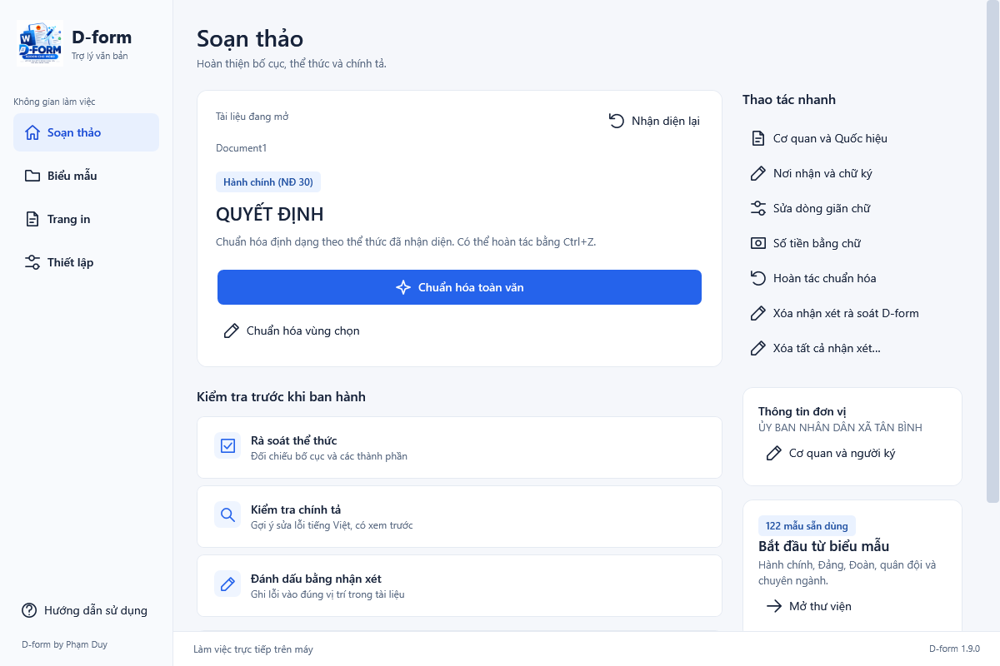

<p align="center">
  
</p>

# D-form — Trợ lý văn bản trong Microsoft Word

D-form hỗ trợ cán bộ soạn thảo và hoàn thiện văn bản ngay trong Word: chọn mẫu, điền thông tin đơn vị, xem trước chuẩn hóa, kiểm tra chính tả và thiết lập trang in.

**Miễn phí · Xử lý tài liệu trên máy · Word desktop 64-bit · Windows**

Bản hiện tại: **1.9.0** — sửa luồng xem trước có thể hủy và giới hạn thời gian; cải thiện nhận diện dòng trống khi dán từ web; thêm quản lý nhận xét rà soát. Đã kiểm thử 42 nhóm và toàn bộ 122 mẫu, cài nâng cấp AllUsers thực tế trên Word 64-bit.

[Trang tải D-form](https://tronieph.github.io/d-form-releases/) · [Ghi chú bản 1.9.0](https://github.com/TroniePh/d-form-releases/releases/tag/v1.9.0)

## Tải phần mềm

Hai bộ cài đều miễn phí; chọn theo phạm vi sử dụng trên máy.

| Bộ cài | Phù hợp với | Quyền quản trị | Tải bản 1.9.0 |
| --- | --- | --- | --- |
| **Free** | Tài khoản Windows hiện tại | Không cần | [Tải Free.exe](https://github.com/TroniePh/d-form-releases/releases/download/v1.9.0/D-form-Setup-v1.9.0-Free.exe) |
| **AllUsers** | Tất cả tài khoản trên máy | Cần | [Tải AllUsers.exe](https://github.com/TroniePh/d-form-releases/releases/download/v1.9.0/D-form-Setup-v1.9.0-AllUsers.exe) |

Máy cần **Microsoft Word desktop 64-bit trên Windows** và **.NET Framework 4.8**. Word 32-bit và Word trên trình duyệt chưa thuộc phạm vi phát hành này.

Đã kiểm thử nâng cấp **AllUsers trên Word 64-bit thực tế**. Cài máy sạch và cài Free thực tế chưa được xác minh trên máy hiện tại; Free đã kiểm tra gói và dùng cùng DLL. Với triển khai tập trung cho cán bộ, ưu tiên AllUsers qua người quản trị máy.

## Cài đặt và bắt đầu sử dụng

1. Lưu tài liệu đang làm và đóng Word.
2. Chạy bộ cài phù hợp. Khi nâng cấp, chọn **cùng loại Free hoặc AllUsers** với bản đang dùng; AllUsers cần xác nhận quyền quản trị Windows.
3. Mở lại Word, chọn tab **D-form → Không gian làm việc** hoặc **Mở bảng điều khiển**.
4. Chọn **Biểu mẫu** để tạo tài liệu, hoặc **Soạn thảo** để xử lý văn bản đang mở. Mở **Thông tin phiên bản** để kiểm tra 1.9.0.

Trước khi chuẩn hóa toàn văn, kiểm tra thể thức đã nhận diện, đọc bảng xem trước rồi chọn **Sao lưu và áp dụng**. Đọc lại nội dung và bố cục trước khi ký ban hành.

## Giao diện



## Tính năng

- **Mới ở 1.9.0:** xem trước có tiến độ, Hủy và giới hạn thời gian; có Áp dụng không xem trước với sao lưu/hoàn tác. Word mở bản sao sau khi đã tắt macro và cập nhật liên kết.
- **Nhận xét rà soát:** xóa riêng nhận xét D-form hoặc xóa toàn bộ sau khi xác nhận; hỗ trợ Ctrl+Z. Có trong menu Rà soát thể thức và công cụ bổ sung.
- **Văn bản dán từ web:** nhận diện thêm các dòng trống chứa khoảng trắng Unicode khi dựng khung cơ quan và chữ ký.

- **Kiểm tra trước ban hành:** rà ô mẫu, số/ký hiệu, ngày, nhận xét và sửa đổi chưa xử lý; chọn vị trí để sửa. Người ký và thẩm quyền cần đối chiếu thủ công.
- **Xuất PDF:** gợi ý tên file, xuất toàn văn bằng Word và xác nhận ghi đè. Xử lý sửa đổi đang theo dõi trước khi xuất.
- **Thư viện 122 mẫu Word:** tìm theo tên/nhóm; xem ảnh thật của 145 trang nguồn, chọn trang và phóng to trước khi tạo tài liệu.
- **Chuẩn hóa có xem trước:** xử lý toàn văn, vùng chọn hoặc từng phần; chọn nhóm định dạng, lưu bản khôi phục và hỗ trợ hoàn tác. Có các lựa chọn hành chính, Đảng, Đoàn, quân đội, văn bản hợp nhất và giáo án.
- **Chèn nhanh 83 thành phần:** hỗ trợ cơ quan, quốc hiệu, nơi nhận, chữ ký và các mức khẩn/mật.
- **Kiểm tra chính tả tiếng Việt:** chọn phạm vi gồm nội dung, đầu/chân trang, chú thích và hộp văn bản; xem trước gợi ý thay thế và quản lý từ điển riêng.
- **Công cụ tiếng Việt:** chuyển mã TCVN3/VNI sang Unicode, đổi kiểu đặt dấu thanh, làm sạch khoảng trắng và chuyển số tiền thành chữ.
- **Trang in và bảng:** khổ giấy/lề, đánh số trang, chèn trang ngang/dọc độc lập và định dạng bảng.
- **Dữ liệu đơn vị và mẫu riêng:** lưu thông tin cơ quan/người ký, nhập/xuất cấu hình, quản lý mẫu cơ quan và mở bản khôi phục thành tài liệu mới.
- **Rà soát và hỗ trợ:** báo cáo thể thức, nhận xét tại vị trí cần kiểm tra và chẩn đoán phiên bản/kết nối/cài đặt.

Luồng xem trước và khôi phục mới dùng tài liệu `.docx` không có macro hoặc mật khẩu. Với tài liệu có macro/mật khẩu, tạo bản làm việc `.docx` phù hợp trước khi dùng các luồng này. Mẫu cơ quan nhập riêng hiện chưa có ảnh xem trước.

Mẫu báo cáo khen thưởng ND152 số 04 có thể tách dòng tiêu đề bảng qua hai trang khi chuẩn hóa. Rà phân trang trước khi gửi; với mẫu đã được đơn vị duyệt, có thể bỏ nhóm **Nội dung** trong màn hình xem trước để giữ định dạng phần này.

## Cập nhật tự động

Cài gói trên trang tải một lần để có bộ cập nhật D-form. Khi bộ cập nhật chạy, phần mềm kiểm tra bản mới mỗi **12 giờ**; có thể kiểm tra ngay qua biểu tượng D-form ở khay Windows hoặc **Start → D-form → Cập nhật D-form**.

- **Free:** tải và xác minh bộ cài, chờ Word đóng rồi cài cập nhật.
- **AllUsers:** cần bấm thông báo cập nhật và xác nhận quyền quản trị; bộ cài chờ Word đóng.
- Có thể bật/tắt cập nhật tự động trong menu khay Windows. Bộ cập nhật không tự đóng Word hoặc sửa tài liệu.

Bộ cài 1.9.0 dùng **kênh ổn định**, chỉ nhận bản phát hành stable. Trang tải ưu tiên bản ổn định khi có; các bản preview riêng dùng để thử nghiệm.

## Dữ liệu và bảo vệ mã

Tài liệu, cấu hình cơ quan, từ điển và bản khôi phục được xử lý/lưu trên máy. Bộ cập nhật lấy thông tin phiên bản và bộ cài từ GitHub; không gửi những dữ liệu này lên GitHub. Cấu hình, hồ sơ và mẫu riêng nằm trong `%APPDATA%\DFormat`; bản khôi phục được giữ đến khi người dùng chủ động xóa.

Từ 1.7.2, DLL và bộ cập nhật được **làm rối tên triển khai và ẩn chuỗi nội bộ** trước khi đóng gói. Mã nguồn gốc, PDB, DLL gốc chưa bảo vệ và bảng đối chiếu tên hàm giữ riêng. Đây là biện pháp làm khó dịch ngược, không bảo đảm chống lấy mã tuyệt đối.

Các bản cũ chưa bảo vệ đã được ẩn khỏi kênh tải công khai và giữ bản lưu riêng. Những bộ cài đã được tải trước đó không thể thu hồi.

## Kiểm tra bộ cài

Mỗi release có [SHA256SUMS.txt](https://github.com/TroniePh/d-form-releases/releases/download/v1.9.0/SHA256SUMS.txt). Đối chiếu mã băm của tệp tải về trước khi sử dụng khi cần:

```powershell
Get-FileHash -Algorithm SHA256 -LiteralPath .\D-form-Setup-v1.9.0-Free.exe
```

Bản 1.9.0 đã qua **42 nhóm kiểm tra trên DLL đã bảo vệ**, **122 mẫu**, **41 kiểm tra bàn giao**, **71 kiểm tra bảo vệ mã** và **24 kiểm tra chính sách cập nhật**. Đã cài nâng cấp AllUsers và kiểm tra thao tác thực tế trên Word 64-bit. Hai bộ cài được giải nén, đối chiếu đủ 287 tệp payload và xác nhận không chứa mã nguồn/PDB/bảng đối chiếu/DLL gốc. Chưa kiểm thử cài trên máy sạch hoặc Word 32-bit. Bộ cài chưa ký chứng thư thương mại; SHA256 có trong release.

## Hỗ trợ

**D-form by Phạm Duy**

- [Zalo: 0868609901](https://zalo.me/0868609901)
- [Facebook: Phạm Duy](https://www.facebook.com/neull)

Khi cần hỗ trợ, gửi phiên bản D-form, phiên bản Word và mô tả thao tác gặp lỗi. Có thể dùng **Thiết lập → Tình trạng cài đặt** để sao chép báo cáo.

## Repository này

Đây là kênh bộ cài, tài liệu và website của D-form. Mã nguồn add-in được giữ riêng. [Releases](https://github.com/TroniePh/d-form-releases/releases) chứa bộ cài; thư mục `docs` chứa website; `scripts/build_feed.py` tạo thông tin tải/cập nhật từ các release đã công khai.

Khi phát hành tiếp, giữ hai bộ cài đã bảo vệ, bộ cập nhật và các tài liệu/checksum của release. Tên tệp `D-form-Setup-vX.Y.Z-Free.exe` và `D-form-Setup-vX.Y.Z-AllUsers.exe` phải khớp tag `vX.Y.Z`. GitHub Actions chọn phiên bản đủ hai bộ cài cao nhất để cập nhật website; quy trình này không thay thế kiểm thử trước phát hành.
